# AtlasBook : infrastructure web trois-tiers sur AWS

**Terraform et Ansible : déploiement, sécurisation et tests**

Ryad ALI, Mastère Cybersécurité 4A, IPSSI

Date : 1er octobre 2026

---

## 1. Contexte et objectif

LocAuto Solutions édite AtlasBook, une plateforme de réservation de véhicules utilitaires. Le site tournait sur un seul serveur. Avec la campagne marketing qui arrive, la fréquentation va monter, et un audit de sécurité a relevé plusieurs problèmes :

- un seul serveur, donc un seul point de panne ;
- une base de données accessible directement depuis les serveurs, sans cloisonnement ;
- un mot de passe de base de données en clair dans un fichier versionné ;
- des documents stockés sans chiffrement ni règle de conservation.

Mon objectif était de livrer une nouvelle version de l'infrastructure qui règle ces points. Elle devait être répartie sur plusieurs zones, cloisonnée en trois niveaux (public, applicatif, données), gérer proprement ses secrets, et être entièrement décrite en code : Terraform pour l'infrastructure, Ansible pour la configuration des serveurs. Le tout est déployé sur un environnement de préproduction AWS, en région `us-east-1`.

## 2. Architecture retenue

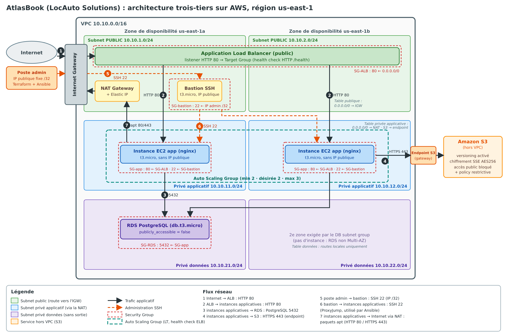

Le trafic suit ce chemin :

1. Internet arrive sur l'**ALB** (Application Load Balancer), placé dans les deux subnets publics.
2. L'ALB envoie les requêtes aux **instances de l'Auto Scaling Group**, dans les subnets privés applicatifs, sans IP publique.
3. Les instances interrogent la base **RDS PostgreSQL**, dans les subnets privés données, sans IP publique non plus.
4. Les instances déposent leurs sauvegardes dans **S3**, par un endpoint privé.
5. Pour l'administration, je passe par un **bastion** placé dans un subnet public. Son SSH n'accepte que mon IP.

| Couche | Subnets | Contenu |
|---|---|---|
| Public | `10.10.1.0/24` (zone a), `10.10.2.0/24` (zone b) | ALB, NAT Gateway, bastion |
| Privé applicatif | `10.10.11.0/24` (zone a), `10.10.12.0/24` (zone b) | instances de l'ASG |
| Privé données | `10.10.21.0/24` (zone a), `10.10.22.0/24` (zone b) | RDS |

Le VPC fait `10.10.0.0/16`. Le projet compte 36 ressources Terraform.

## 3. Choix techniques

### 3.1 Adressage

J'ai pris un `/16` pour le VPC et un `/24` par subnet. Les plages sont séparées par couche (1 et 2 pour le public, 11 et 12 pour l'applicatif, 21 et 22 pour les données). On reconnaît donc la couche d'une adresse au premier coup d'œil. Les zones de disponibilité sont lues dynamiquement avec une data source, pour ne pas dépendre d'un nom de zone écrit en dur.

### 3.2 Security Groups en cascade

Chaque couche n'accepte que la couche juste au-dessus, désignée par son Security Group et non par une plage d'adresses :

| Security Group | Entrée autorisée | Sortie |
|---|---|---|
| ALB | HTTP 80 depuis Internet | HTTP 80 vers les subnets applicatifs |
| Bastion | SSH 22 depuis mon IP en `/32` | SSH 22 vers les subnets applicatifs |
| Applicatif | HTTP 80 depuis le SG de l'ALB, SSH 22 depuis le SG du bastion | 80 et 443 (paquets, S3), 5432 vers les subnets données |
| RDS | PostgreSQL 5432 depuis le SG applicatif | aucune |

Référencer un Security Group plutôt qu'une plage a un avantage : la règle reste juste si une instance est remplacée et change d'adresse, ce qui arrive en permanence avec un ASG. Une plage d'adresses laisserait passer n'importe quelle machine du subnet. Le SG de RDS n'a aucune règle de sortie, car une base managée n'ouvre aucune connexion de son côté.

Une limite : les sorties 80 et 443 du SG applicatif sont ouvertes vers `0.0.0.0/0`, car les instances installent des paquets depuis des miroirs dont les adresses ne sont pas fixes.

### 3.3 ALB, health check et Auto Scaling Group

**Health check.** Le Target Group interroge `/health`, un chemin qui répond `200` sans passer par PHP ni par la base. Ainsi, une panne de RDS ne fait pas retirer toutes les instances du service. Les réglages :

| Paramètre | Valeur | Raison |
|---|---|---|
| Intervalle | 15 s | réaction assez rapide |
| Timeout | 5 s | assez large pour une réponse locale |
| Seuil sain | 2 succès | instance déclarée saine en 30 s |
| Seuil défaillant | 3 échecs | 45 s avant retrait, pour ne pas réagir à un incident très court |
| Délai de grâce de l'ASG | 300 s | laisse le temps au démarrage |

**Capacité.** L'ASG est réglé sur `min 2`, `désirée 2`, `max 3`. Le minimum de 2 donne une instance par zone, donc la panne d'une zone ne coupe pas le service. Le maximum de 3 laisse de la marge sans dépasser le quota de vCPU du compte. Je n'ai pas ajouté de politique de scaling : l'ASG reste à 2 instances, et le maximum ne sert que de garde-fou.

Le health check de l'ASG est de type `ELB` : une instance jugée défaillante par l'ALB est remplacée, pas seulement une instance arrêtée.

**Démarrage minimal.** Le `user_data` du Launch Template installe seulement nginx et expose `/health`. Une instance neuve devient donc saine tout de suite, et l'ASG ne la remplace pas en boucle en attendant Ansible. La vraie configuration vient ensuite d'Ansible.

### 3.4 Base de données et gestion du secret

J'ai choisi **PostgreSQL 16.15** sur une instance `db.t3.micro`, avec 20 Go de stockage chiffré. L'instance n'est pas publique (`publicly_accessible = false`). Elle est fixée en zone a, pour correspondre au schéma. Un groupe de sous-réseaux sur deux zones est quand même nécessaire : RDS l'exige pour pouvoir relocaliser l'instance en cas de panne. Je n'ai pas activé le Multi-AZ, pour limiter le coût d'un environnement de préproduction.

**Le secret** suit un parcours à deux niveaux :

- **Terraform** : le mot de passe est une variable `db_password` marquée `sensitive = true`, sans valeur par défaut. Sa valeur est dans `terraform.tfvars`, un fichier ignoré par git. Un `terraform.tfvars.example` sans valeur réelle, lui, est versionné. Le mot de passe est généré aléatoirement, et je ne l'ai jamais affiché.
- **Ansible** : le mot de passe est dans `group_vars/role_app/vault.yml`, chiffré avec Ansible Vault. Le script `make_vault.sh` le recopie depuis `terraform.tfvars` : il n'y a qu'une source, et il n'est jamais retapé. Le mot de passe du coffre est stocké hors du dépôt, dans `~/.ansible/`.

Sur les serveurs, il n'est écrit que dans `/etc/atlasbook/db.php`, en `0640` pour `root:www-data` : PHP peut le lire, aucun autre compte non plus. La tâche qui le dépose utilise `no_log`. La page de test affiche l'endpoint et le résultat de la connexion, mais jamais le mot de passe ni le message d'erreur brut.

### 3.5 Stockage S3

Le bucket a un nom unique grâce à un suffixe aléatoire (`random_id`). Il est protégé de quatre façons :

- **versioning** : on peut retrouver une version écrasée ou supprimée par erreur ;
- **chiffrement par défaut** AES256 ;
- **blocage d'accès public** complet ;
- **policy restrictive** avec deux refus : le trafic non chiffré (TLS obligatoire) et tout principal extérieur au compte.

Une règle de rétention supprime les anciennes versions après 90 jours et les téléversements incomplets après 7 jours. Sans elle, le versioning garderait tout indéfiniment et le coût dériverait.

### 3.6 Sortie Internet et accès à S3

Les instances applicatives n'ont pas d'IP publique mais doivent installer des paquets. Elles sortent donc par une **NAT Gateway** avec une Elastic IP, placée dans un subnet public. J'ai choisi **une seule NAT** (zone a), pour le coût. Le revers est qu'elle devient un point de défaillance unique pour la sortie, pas pour l'entrée, qui reste multi-zone. Les subnets de données n'ont aucune route sortante.

Pour S3, j'ai ajouté un **endpoint de type gateway**, rattaché uniquement à la table de routage applicative. Le trafic vers S3 reste dans le réseau AWS : il ne passe ni par la NAT ni par Internet, et il n'est pas facturé au volume de la NAT.

### 3.7 Ansible : inventaire dynamique

**Le problème.** Les instances sont gérées par l'ASG : leur nombre et leurs adresses changent sans que j'exécute quoi que ce soit. Un inventaire écrit à la main serait faux au premier remplacement.

**La méthode retenue** est le plugin `amazon.aws.aws_ec2`. Il interroge l'API EC2 à chaque exécution et ne garde que les instances qui ont le tag `Project=atlasbook` et sont en fonctionnement. Il utilise l'IP privée comme adresse de connexion et crée des groupes à partir du tag `Role` (`role_app`, `role_bastion`) et de la zone. Le playbook cible `role_app`, sans lister aucune machine.

J'ai préféré le plugin au script `describe-instances` : il est intégré à Ansible, filtre et groupe sans code supplémentaire, et sert de documentation de la méthode.

**Accès par le bastion.** Les instances n'ont pas d'IP publique. Ansible passe donc par le bastion avec une option `ProxyCommand` définie dans les `group_vars`. L'IP du bastion est retrouvée dans l'inventaire, via son tag `Role=bastion`, et n'est jamais écrite en dur. J'ai pris `ProxyCommand` plutôt que `ProxyJump` pour pouvoir passer les options de clé d'hôte au saut intermédiaire, ce que `ProxyJump` ne fait pas.

**Limites connues de cette méthode :**

- elle demande des identifiants AWS valides au moment du lancement ;
- une instance de remplacement n'est configurée qu'au prochain passage du playbook (voir la section 4.6) ;
- le plugin affiche un avertissement de dépréciation sur la variable `tags`, qu'il pose lui-même. Je filtre déjà avec `ec2_tags`, la variable recommandée, et l'avertissement subsiste sans effet.

**Réglage justifié.** `host_key_checking` est désactivé, car chaque instance remplacée reçoit une nouvelle clé d'hôte, ce qui bloquerait Ansible à chaque rotation. Le risque est limité : les instances ne sont joignables que depuis le bastion, sur un réseau privé.

**Les rôles.**

- **`common`** : mise à jour du cache de paquets, outils de base, fuseau horaire, durcissement SSH (`PermitRootLogin no`, `PasswordAuthentication no`) avec contrôle de syntaxe par `sshd -t` avant remplacement du fichier, et une bannière de connexion. Le rechargement de `sshd` passe par un handler.
- **`webapp`** : nginx, PHP-FPM et le pilote PostgreSQL, un vhost généré par un template Jinja2, la configuration d'accès à la base (avec `no_log`), et la page de test. nginx n'est rechargé que si une configuration a changé, ce qui rend le playbook idempotent.

À la fin du playbook, des tâches `uri` et `assert` contrôlent que `/health` répond `200`, que la page affiche `Connexion RDS : OK`, et que le mot de passe n'apparaît pas dans la page.

## 4. Déroulement et résultats

Les captures de la console et des terminaux datent d'après l'incident décrit à la section 4.5. Les identifiants d'instances qu'on y voit sont donc ceux des instances de remplacement, pas ceux du tout premier déploiement. Les sorties du premier déploiement sont conservées dans les fichiers `terraform/apply_output.txt`, `ansible/run1_output.txt` et `ansible/run2_output.txt`.

### 4.1 Terraform

```
terraform init        # providers aws 5.100 et random 3.9
terraform validate    # Success! The configuration is valid.
terraform plan        # Plan: 36 to add, 0 to change, 0 to destroy.
./apply.sh -auto-approve
```

Au premier passage de l'`apply`, 31 ressources ont été créées, puis la ressource S3 a échoué (voir la section 5). Le script `apply.sh` a appliqué son contournement et créé les 5 ressources restantes. Les temps de création les plus longs :

| Ressource | Durée |
|---|---|
| NAT Gateway | 1 min 55 s |
| ALB | 2 min 13 s |
| RDS | 5 min 07 s |
| Total (deux passages) | 6 min 45 s |

Sorties Terraform :

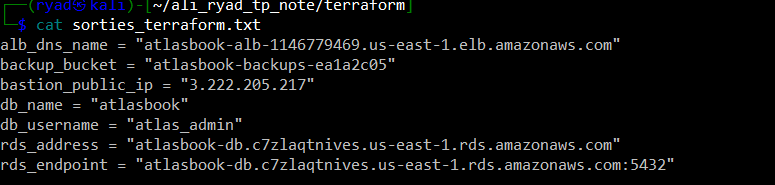

Les deux cibles de l'ALB sont passées `healthy` du premier coup, et `/health` répondait `200`.

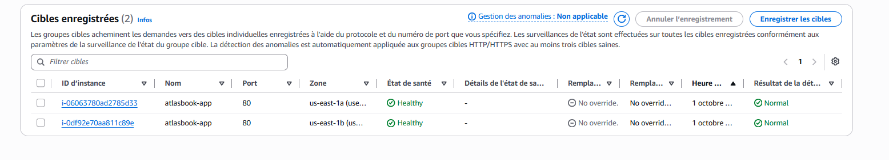

Les instances applicatives n'ont aucune IP publique, contrairement au bastion :

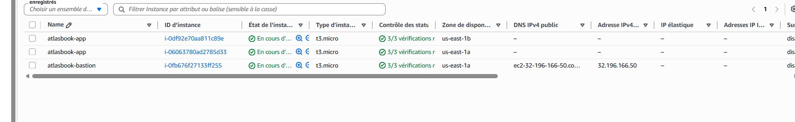

### 4.2 Contrôles Ansible avant application

| Contrôle | Résultat |
|---|---|
| `ansible-inventory --graph` | 3 instances, groupes `role_app`, `role_bastion` et par zone |
| `ansible role_app -m ping` | `pong` sur les deux instances privées, par le bastion |
| `ansible-playbook site.yml --syntax-check` | pas d'erreur |
| `ansible-playbook site.yml --check --diff` | `failed=0` |
| `ansible-lint` | `Passed: 0 failure(s), 0 warning(s) in 17 files processed of 24 encountered` |

### 4.3 Exécution du playbook et idempotence

Le script `run.sh` lit l'endpoint RDS, le nom de la base et le compte dans les sorties Terraform et les passe à Ansible. Un premier passage configure des instances neuves. Le premier passage du matin a donné `ok=22 changed=15` (voir `ansible/run1_output.txt`). La capture ci-dessous est celle du passage refait après l'incident, sur les instances de remplacement, avec le même résultat :

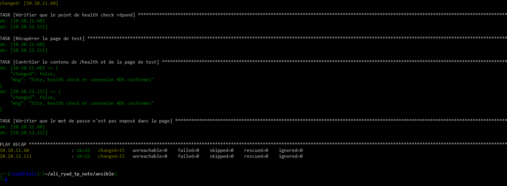

Le second passage ne change plus rien :

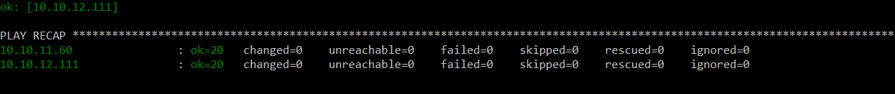

| Passage | `ok` | `changed` | `failed` |
|---|---|---|---|
| 1 (instances neuves) | 22 | 15 | 0 |
| 2 (idempotence) | 20 | 0 | 0 |

### 4.4 Vérification du site, répartition de charge et isolation

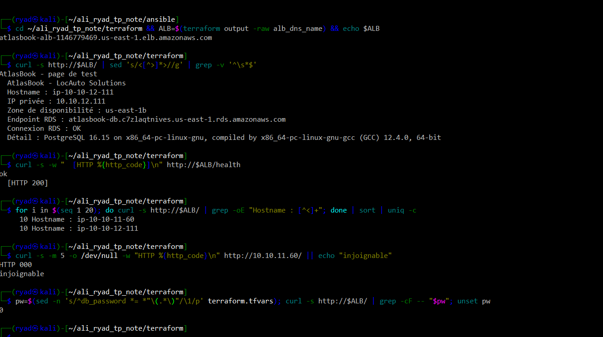

- La page de test affiche le nom d'hôte, l'IP privée, la zone, l'endpoint RDS et `Connexion RDS : OK` avec la version `PostgreSQL 16.15`.
- Sur 20 requêtes, 10 vont à `ip-10-10-11-60` (zone a) et 10 à `ip-10-10-12-111` (zone b).
- Un accès direct à l'IP privée d'une instance depuis ma machine échoue (`HTTP 000`) : elle n'est pas joignable depuis Internet.
- Le mot de passe n'apparaît pas dans la page (0 occurrence).

Configuration de S3 et de RDS vérifiée en ligne de commande :

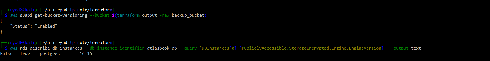

### 4.5 Incident en cours de test

Entre le premier déploiement et ces tests, la console AWS de l'Academy a renvoyé une erreur 503, et mes identifiants ont été révoqués. Les instances applicatives avaient été remplacées par l'ASG, et le bastion avait une nouvelle IP publique. Vers 14 h (heure de Paris), les deux instances d'origine ont été terminées puis recréées par l'ASG (voir l'historique à la section 4.6). Mon hypothèse est que la session du lab, qui dure environ 4 heures, s'est terminée. Je n'ai pas pu le confirmer.

Après avoir relancé le lab et renouvelé les identifiants, l'ALB répondait toujours `200`, mais il servait la page d'amorçage (« instance amorcee, configuration Ansible en attente ») : les instances de remplacement n'avaient que le `user_data`. Un passage de `run.sh` les a reconfigurées, sans modifier l'inventaire (capture 01 de la section 4.3). Cet incident a illustré, sans que je le cherche, le comportement décrit à la section suivante.

### 4.6 Test de résilience volontaire

J'ai résilié à la main une instance `atlasbook-app` depuis la console :

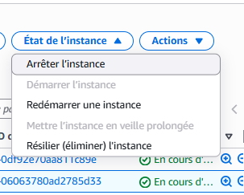

L'ASG a lancé une remplaçante quelques secondes plus tard :

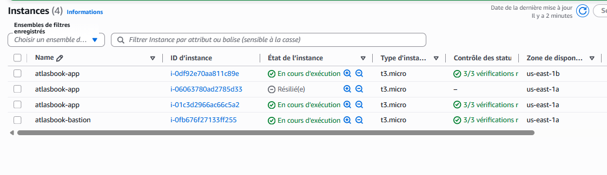

L'historique de l'ASG le confirme (heures en UTC, soit deux heures de moins qu'à Paris) :

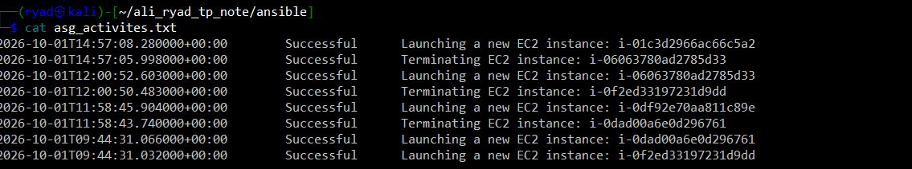

Entre la résiliation et le passage d'Ansible, la remplaçante est déjà dans l'ALB (elle répond `200` sur `/health`) mais sert la page d'amorçage. J'ai relancé `./run.sh` **sans modifier l'inventaire** :

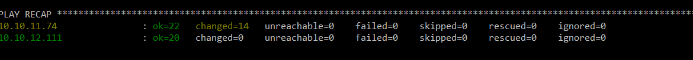

L'instance restée en place est inchangée (`changed=0`). La nouvelle instance, `10.10.11.74`, a été découverte et configurée automatiquement (`changed=14`). La répartition de charge fonctionne sur les deux instances :

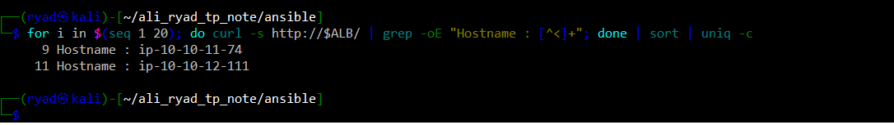

Un dernier passage confirme que la remplaçante est stable :

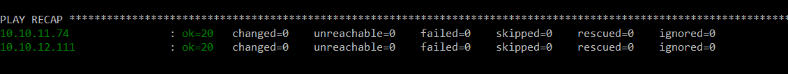

| Passage | Contexte | Résultat |
|---|---|---|
| 1 | instances neuves | `changed=15` sur les deux |
| 2 | idempotence | `changed=0` sur les deux |
| 3 | après résilience | `changed=14` sur la remplaçante, `changed=0` sur l'autre |
| 4 | idempotence après résilience | `changed=0` sur les deux |

**La limite.** Une instance de remplacement n'est pas configurée tant que le playbook n'est pas relancé. Pendant cet intervalle, elle reçoit du trafic et sert la page d'amorçage. Trois pistes pour supprimer cette étape manuelle :

- **`ansible-pull` dans le `user_data`** : l'instance récupère le playbook et se configure toute seule au démarrage ;
- **une AMI préconfigurée** (avec Packer, par exemple) : la configuration est déjà dans l'image, et l'instance est prête dès qu'elle démarre ;
- **un déclenchement automatique** du playbook à chaque remplacement d'instance (hook de cycle de vie de l'ASG, ou un événement qui lance Ansible).

### 4.7 Nettoyage

```
./destroy.sh -auto-approve
Destroy complete! Resources: 36 destroyed.
```

Les 36 ressources créées ont été détruites sans erreur, et l'état Terraform est vide. L'ASG a mis 1 min 31 s à disparaître et le RDS 1 min 51 s. L'option `-refresh=false` du script est expliquée à la section suivante.

La console AWS confirme qu'il ne reste rien : aucune base de données RDS et aucun équilibreur de charge. Les quatre instances du projet (trois applicatives, dont deux remplaçantes, et le bastion) sont à l'état « Résilié(e) ». Une instance résiliée reste affichée un moment dans la liste avant de disparaître, sans coût.

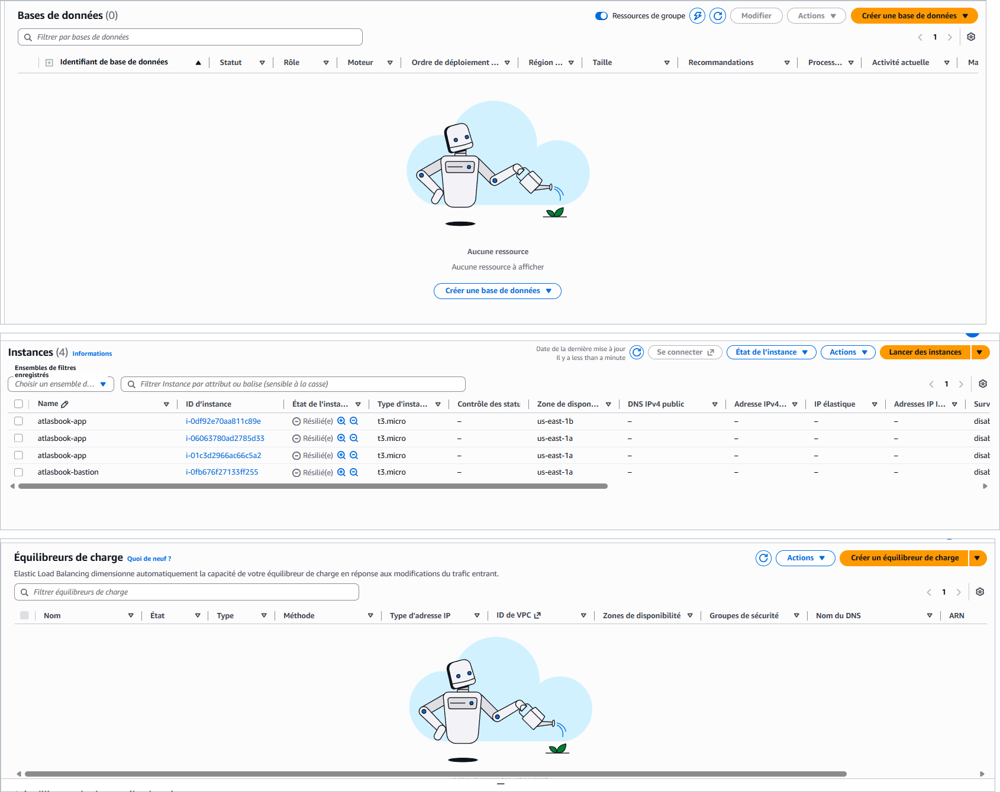

## 5. Retour d'expérience

### Difficultés rencontrées

**La lecture d'Object Lock sur S3 est refusée.** Le provider AWS lit la configuration Object Lock du bucket juste après l'avoir créé. L'environnement l'interdit par une politique de sécurité (une SCP), donc la ressource passait en échec alors que le bucket existait bel et bien. Aucune version du provider ne contournait le problème, je l'avais testé sur un projet précédent. J'ai écrit deux petits scripts. `apply.sh` retire la marque d'échec du bucket puis réapplique avec `-refresh=false`. `destroy.sh` utilise `-refresh=false` pour que la destruction ne tombe pas sur la même lecture. Ce n'est pas élégant, mais c'est documenté et reproductible.

**Création du coffre Ansible.** Ma première version du script `make_vault.sh` échouait avec « the vault-ids default,default are available ». J'avais déclaré le fichier de mot de passe à la fois dans `ansible.cfg` et en ligne de commande, ce qui créait deux identités de coffre identiques. J'ai retiré l'option de la ligne de commande.

**Le mode `--check` échouait.** Les tâches de contrôle de fin utilisent le module `uri`, que le mode `--check` saute : l'assertion suivante plantait faute de résultat. Ces requêtes sont en lecture seule, j'ai donc forcé leur exécution avec `check_mode: false`.

**Fin de session du lab.** Comme décrit à la section 4.5, mes identifiants ont été révoqués, les instances ont été remplacées et le bastion a changé d'IP. J'ai dû relancer le lab, renouveler les identifiants, puis relancer Ansible. L'inventaire dynamique a retrouvé la nouvelle IP du bastion tout seul, sans que je modifie un fichier.

### Ce qui reste perfectible

- **Pas de HTTPS.** L'ALB n'écoute qu'en HTTP. En production, il faudrait un certificat et un listener 443.
- **Pas de scaling automatique.** L'ASG reste à 2 instances. Une politique basée sur le CPU l'ajouterait.
- **Une seule NAT.** C'est un point de défaillance unique pour la sortie. Une NAT par zone le supprimerait, au prix d'un coût double.
- **RDS en une seule zone.** Une panne de cette zone coupe la base. Le Multi-AZ règlerait cela.
- **Bastion sans IP fixe.** Son IP change à chaque arrêt, ce qui m'a gêné après l'incident. Une Elastic IP, ou la connexion par AWS Systems Manager à la place du bastion, serait plus stable.
- **Le mot de passe est dans le state Terraform.** Même marqué sensible, il est stocké en clair dans `terraform.tfstate`. Je le protège en ne versionnant jamais ce fichier. Un backend distant chiffré serait préférable.
- **La configuration n'est pas automatique pour les remplaçantes.** C'est la limite décrite à la section 4.6.
- **Sorties 80 et 443 ouvertes** sur le SG applicatif, pour les paquets.

### Ce que j'en retiens

Le plus utile a été de construire par couches et de tester chacune. Le réseau, les Security Groups et l'ASG ont d'abord été validés par `plan`, ce qui a évité de chercher les erreurs dans un ensemble de 36 ressources. L'inventaire dynamique m'a surtout appris pourquoi un inventaire à la main ne tient pas avec un ASG : le test de résilience, volontaire puis involontaire, l'a montré deux fois.

---

## Annexe : contenu du rendu

```
ali_ryad_tp_note/
├── terraform/    # fichiers .tf, user_data.sh, apply.sh, destroy.sh,
│                 # terraform.tfvars.example, .gitignore
├── ansible/      # ansible.cfg, site.yml, inventory/, group_vars/ (vault.yml chiffré),
│                 # roles/common, roles/webapp, run.sh, make_vault.sh
├── schema.png    # schéma d'infrastructure
└── rapport.pdf   # ce document
```
